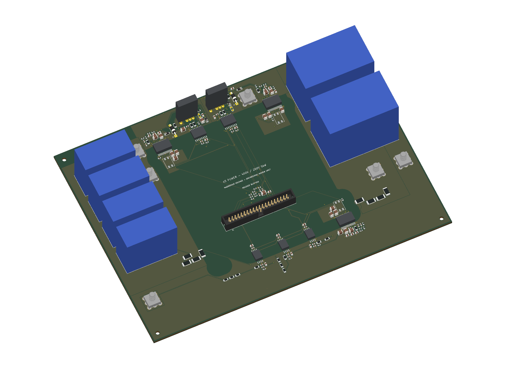
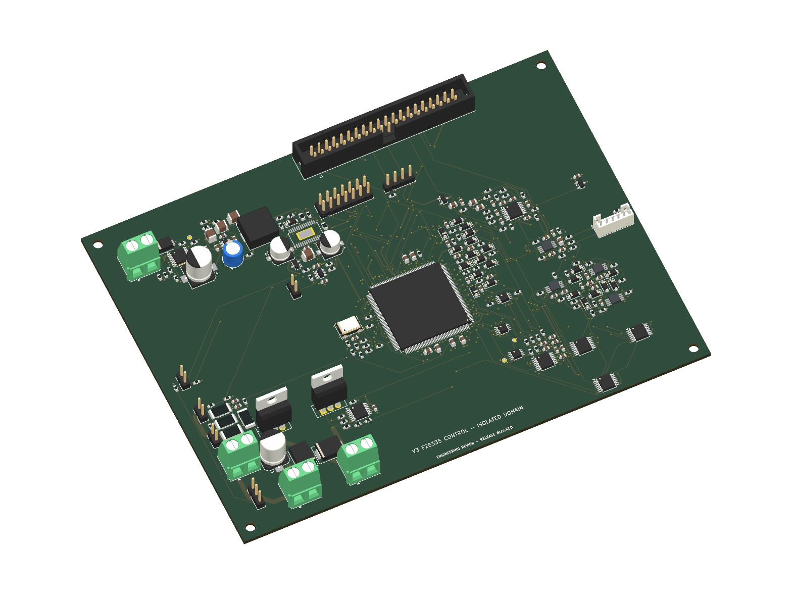

# V3 — 400 V to 200 V, 5 kW SiC buck

**Engineering prototype review package. CAD VERIFIED; behavioural SIMULATION VERIFIED; HARDWARE VALIDATION PENDING; RELEASE BLOCKED.** Editable design and intended PCB routing are complete. The assembly/process qualifications in the release register remain open; no purchasing, fabrication, energisation or merge is authorized by these files.

Start with the [design review](review/design_review_report.md), [remaining issues](review/remaining_issues.md), [18-issue V2.2 disposition](review/v22_issue_resolution_matrix.md) and [V2.2 comparison](review/v22_vs_v3_comparison.md). The [knowledge audit](review/knowledge_utilisation.md) links sources to decisions and reusable tools.

| Deliverable | Location |
|---|---|
| User requirements, assumptions, baseline and source hashes | `requirements/` |
| Architecture alternatives and selection | `architecture/` |
| Electrical calculations and operating corners | `calculations/`, reproducible `automation/sic_v3/calculations.py` |
| Parts and off-board assembly BOM | `components/`, exact circuit records in `design/circuit_*.json` |
| Native projects | `kicad/power_board/sic-v3-power.kicad_pro`, `kicad/control_board/sic-v3-control.kicad_pro`, `kicad/system_wiring/sic-v3-system.kicad_pro` |
| Schematics | [Power, 9 pages](review/schematic_power.pdf), [control, 9 pages](review/schematic_control.pdf), [system wiring, 5 pages](review/schematic_system.pdf) |
| Independent floorplans and final copper review | `pcb/floorplan_candidates/`, `pcb/routing_analysis/` |
| Simulation decks, logs, data and model limits | `simulation/` |
| F28335 executed reference and implementation specification | `firmware/implementation_specification.md`, `automation/sic_v3/simulation.py` |
| Mechanical envelope, supports, thermal fixture, harness and STEP | `mechanical/` |
| Gerber/drill/BOM/placements/STEP/native export manifests | `manufacturing/power/`, `manufacturing/control/` |
| PCB layout and assembly PDFs, 2D/3D views | `review/pcb_*.pdf`, `review/assembly_*.pdf`, PNGs below |
| Native and independent checks | `verification/`, final gate summary `verification/final_validation.json` |
| Frozen review content hashes and reproduction | `review/package_manifest.json`, [reproduce.md](review/reproduce.md) |

Power: 250 × 180 mm, four 70 µm copper layers, 202 footprints. Control: 160 × 120 mm, four 35 µm layers, 266 footprints. Both have zero native DRC findings, unintended opens and schematic-parity differences under the recorded rule configuration. Three native schematic projects have zero ERC findings. Native CAD success does not establish hardware safety/performance.

Historical designs are unchanged at baseline `20e96fdfa5ea76649daa416ee70b7ea7798a319d`. V3 is larger than V2.2 and does not claim better measured efficiency, EMI, switching stress or transient performance. No software was installed for this task.
