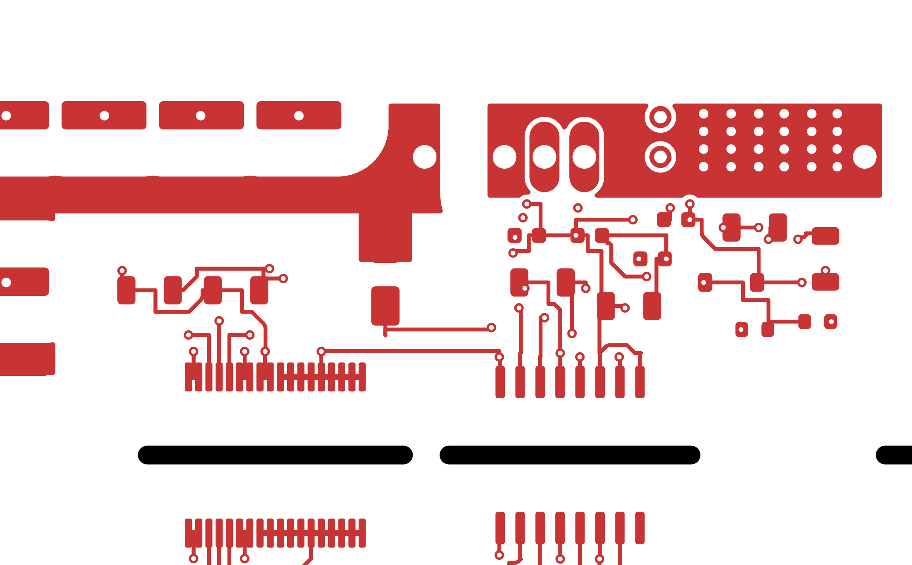
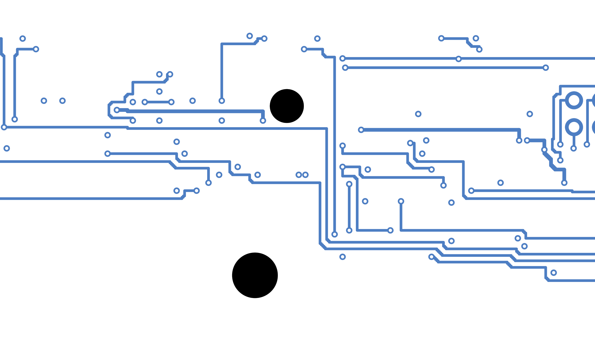
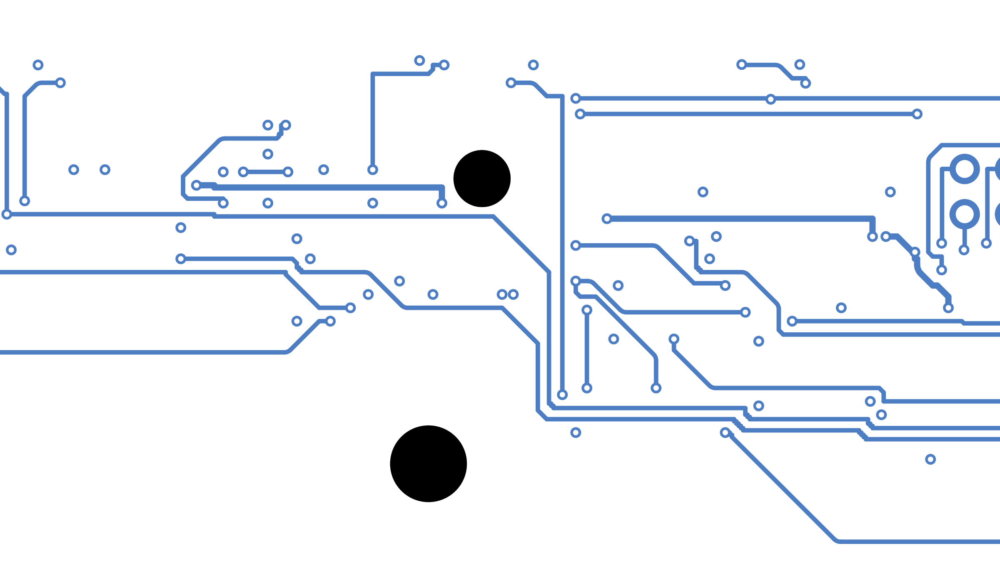
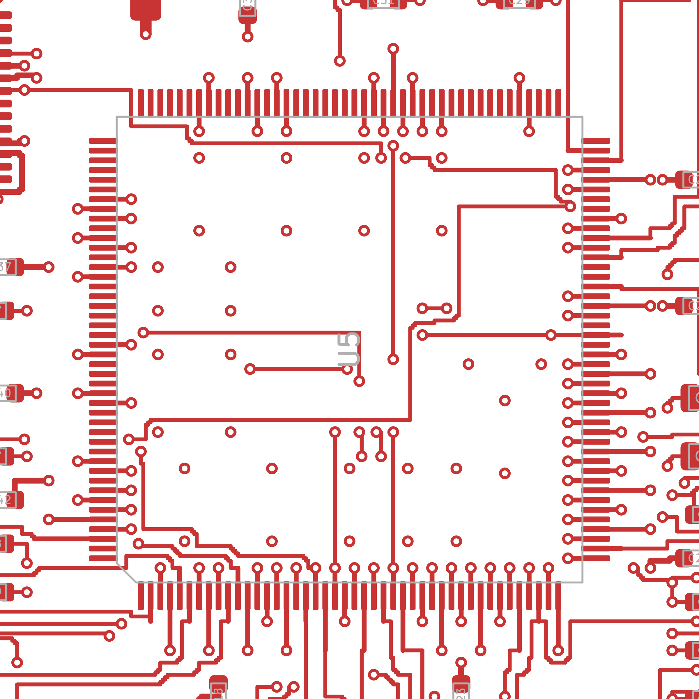
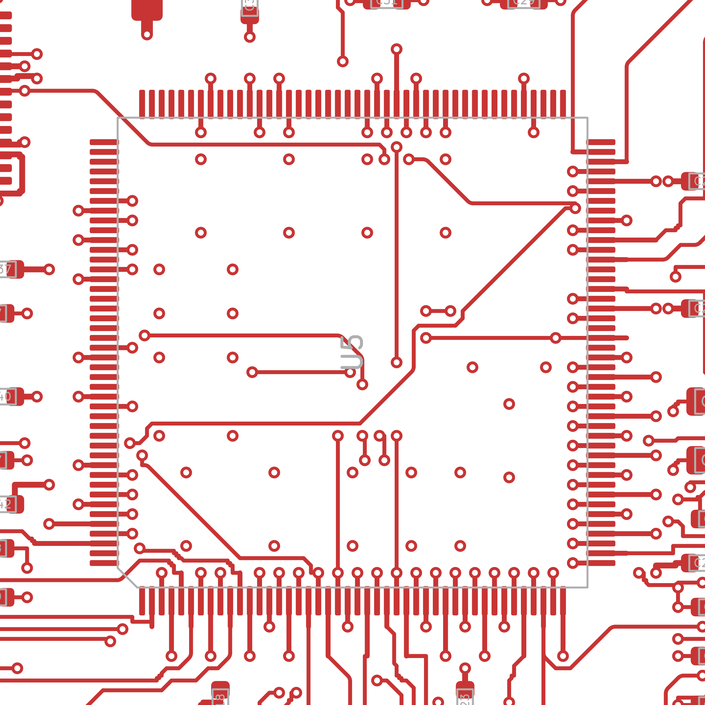

**AI-GENERATED ENGINEERING PROTOTYPE V2.1 - HUMAN REVIEW REQUIRED**

# V2 vs V2.1: schematic readability and PCB routing quality (TASK 8 before/after report)

Written 2026-10-12 for branch `feat/sic-buck-v2.1-quality` (HEAD 7f93a61). Machine-readable twin: [`v2_v21_comparison.json`](v2_v21_comparison.json), built by a script that reads the files named below (its `sources_sha256` map lists every file with its hash). "Before" is the frozen V2 release under [`../releases/v2/`](../releases/v2/) (read-only); "after" is the working tree. V2.1 changed two things: how the schematics are drawn and the geometry of the routed copper. The electrical design (topology, parts, operating point, two-board architecture, placement, rules) is the V2 design, and the V2 open engineering issues in [`../verification/known_issues.md`](../verification/known_issues.md) stay open. Every check quoted here is CAD evidence (native KiCad 10.0.7 ERC/DRC, generator gates, geometry checkers). Zero findings is not electrical, thermal or EMI validation; nothing has been built or measured.

## 0. Key numbers

| Quantity | Power board V2 -> V2.1 | Control board V2 -> V2.1 | Source |
|---|---|---|---|
| Schematic sheets (continuation sheets) | 12 (5) -> 7 (0) | 10 (1) -> 9 (0) | `verification/engineering_checks/schematic_readability_<board>.md`, totals |
| Global labels on pin stubs | 648 -> 7 | 667 -> 7 | same |
| Wired pin share | 0.000 -> 0.897 | 0.000 -> 0.757 | same |
| Hierarchical labels / junctions / power symbols | 0 / 0 / 15 -> 71 / 302 / 230 | 0 / 0 / 3 -> 162 / 263 / 182 | same |
| Netlist (ref, pad) -> net against the V2 netlist | exact, 648 pads, names equal | exact, 667 pads, names equal | `verification/schematic_gates/<board>/schematic_gates.json` |
| ERC findings (--severity-all) | 0 on 12 sheets -> 0 on 7 sheets | 0 on 10 -> 0 on 9 | ERC manifests, section 2.8 |
| Straight segments / PCB arcs | 4755 / 0 -> 2991 / 145 | 5995 / 0 -> 4262 / 261 | `verification/engineering_checks/routing_quality_<board>_compare.md` |
| 90-degree bends | 3609 -> 1121 | 4069 -> 1233 | same |
| Stair-step runs | 382 -> 124 | 435 -> 144 | same |
| Routed length mm | 5744.6 -> 5545.6 | 7055.2 -> 6700.7 | same |
| Vias | 606 -> 606 | 798 -> 798 | same |
| Routing efficiency | 0.776 -> 0.806 | 0.780 -> 0.827 | same |
| Nets longer / with more vias / narrower than V2 | 0 / 0 / 0 | 0 / 0 / 0 | same |
| DRC violations / unconnected / parity | 0 / 0 / 0 -> 0 / 0 / 0 | 0 / 0 / 0 -> 0 / 0 / 0 | DRC manifests, section 2.8 |
| Independent validation rows (TASK 7 items 1-9 plus L, R, D, V) | 13 rows PASS (rows 5, 6, L and D pass with open points 1, 2, 4, 5 and 12 noted; section 5) | same: one validation covers both boards | [`../verification/v21_validation.md`](../verification/v21_validation.md) |

## 1. Schematics

### 1.1 Sheet organisation before and after

V2 drew every pin with a global label and spilled the dense sheets onto continuation sheets "(2)". V2.1 draws one sheet per functional block with wires, junctions, power symbols and hierarchical labels, and escalates the paper size instead of adding sheets. Titles and papers are read from the `.kicad_sch` title blocks in `kicad/<board>_board/` and `releases/v2/kicad/<board>_board/`; fills are the hull / drawable ratios of the `paper_fill` gate in `schematic_gates.json`.

Power board (root `AIPE_SiC_Buck_Power.kicad_sch`: A3 in both generations, rev `V2` -> `V2.1`):

| Sheet file | Title (unchanged) | V2 paper (sheets) | V2.1 paper (fill) |
|---|---|---|---|
| 01_power_stage | Input, half bridge, inductor, output, bleeders | A3 x 2 | A3 (0.807) |
| 02_gate_driver_hs | High-side isolated gate driver and bias | A3 x 2 | A2 (0.538) |
| 03_gate_driver_ls | Low-side isolated gate driver and bias | A3 x 2 | A2 (0.535) |
| 04_sensing_island | Isolated voltage sensing island and its bias module | A3 x 2 | A2 (0.406) |
| 05_selv_strip | SELV strip: mezzanine, conditioning, relay and fan interface | A3 x 2 | A2 (0.526) |
| 06_mechanical | Heatsink envelope, terminals, mounting, test points | A3 x 1 | A3 (0.221) |

Control board (root `AIPE_SiC_Buck_Control.kicad_sch`: A3 -> A2, fill 0.628):

| Sheet file | Title (unchanged) | V2 paper (sheets) | V2.1 paper (fill) |
|---|---|---|---|
| 01_aux_12v | 12 V entry, TVS and TPS26400 eFuse | A3 x 1 | A3 (0.345) |
| 02_supplies | 5 V buck, dual LDO, supervisor and reset | A3 x 1 | A2 (0.65) |
| 03_dsp | TMS320F28335 - all 176 pins | A3 x 1 | A3 (0.305) |
| 04_dsp_decoupling | DSP per-pin bypass and ADC reference | A3 x 1 | A3 (0.329) |
| 05_clock_debug | Oscillator, boot straps, JTAG, UART | A3 x 1 | A3 (0.662) |
| 06_pwm_fault_logic | PWM gating, fault latch, combiners, comparators | A3 x 2 | A2 (0.68) |
| 07_adc_frontend | ADC conditioning, NTC readout, monitors | A3 x 1 | A3 (0.517) |
| 08_interconnect | Mezzanine header, connectors, LEDs, test points, mounting | A3 x 1 | A3 (0.581) |

The root title fields still read "AIPE V2 SiC buck ... board" by design: V2 names the design generation, the revision field says V2.1 ([`../verification/v21_validation.md`](../verification/v21_validation.md), open point 6). PDFs: [`schematic_power.pdf`](schematic_power.pdf) has 7 pages (V2: [`../releases/v2/review/schematic_power.pdf`](../releases/v2/review/schematic_power.pdf), 12 pages); [`schematic_control.pdf`](schematic_control.pdf) has 9 pages (V2: 10). Page counts and paper sizes were read with pymupdf and are stored under `schematics.pdfs` in the JSON twin.

### 1.2 Representative circuit sections

Rendered from the review PDFs with pymupdf at 200 dpi into [`schematic_sections/`](schematic_sections/); clip windows in sheet millimetres, pixel sizes and hashes are in [`schematic_sections/sections.json`](schematic_sections/sections.json). The V2 pages are grids of isolated symbols, so each V2 clip covers the rows that hold the same parts as the V2.1 group. The observations come from looking at each PNG.

| Section | V2 | V2.1 | What the pictures show |
|---|---|---|---|
| Power: HS gate driver (U1 UCC21710, gate network, DESAT, decoupling) | [png](schematic_sections/power_gate_driver_hs_v2.png) | [png](schematic_sections/power_gate_driver_hs_v21.png) | V2: U1 with a label on every pin and 30 other parts in a six-column grid, every pin a global label. V2.1: OUTH/OUTL/CLMPI wired through R19-R21 to the HS_OUTH / HS_OUTL / HS_CLMP ports, R22 and TP1 on the gate-source node, DNP parts R23, C21 and D4 crossed, IN+/IN- with the C20/R18 filter and R17 to the PWM_H port, RDY/FLT with the R27/R28 pull-ups, three decoupling rows between named rails, DESAT chain VDD_H - R24 - D3 - R25 - R26/C29. Weak: the vertical HS_OUTH port stands against the U1 pin stubs and the flat KS_H ground glyph at COM is cramped. |
| Power: HS bias module (U2 UCC14141, L2, feedback dividers) | [png](schematic_sections/power_hs_bias_v2.png) | [png](schematic_sections/power_hs_bias_v21.png) | V2: a label on each of the 36 pins (GNDP_H 14 times, VEE_H 13 times), parts in rows. V2.1: the GNDP and VEE pin groups are bussed to one power symbol each, the FBVDD/FBVEE dividers (R29/R30/C34, R31/R32/C35) are ladders at the pins, RLIM carries R33, PG has R34 to the PG_BIAS_H_N port, the choke L2 sits between 12V_PROT and 12V_BIAS_H, decoupling in rows. |
| Power: power-stage sheet (whole sheet) | [png](schematic_sections/power_power_stage_v2.png) | [png](schematic_sections/power_power_stage_v21.png) | V2: a 6 x 7 grid of terminals, MOSFETs and capacitors with VIN/PGND/SW labels (its continuation sheet held C17-C19, R13-R16 and H1). V2.1: seven titled groups on one A3 (six circuit groups plus the PWR_FLAG supply-provenance group); the HF/DC-link bank C1-C12 is one ladder between VIN and PGND, L1 feeds the TMCS1133 U10 with C13/C14 on VOUT, bleeders and LIVE indicators are two chains, the DNP snubber, damping and PE parts are crossed. Weak: Q1 and Q2 stand side by side with SW as a horizontal wire from Q1 source to Q2 drain instead of the VIN-SW-PGND stack an engineer expects, and the Q1 value text collides with the VIN symbol (one of this sheet's text overlaps). |
| Control: 12 V entry (J1, D1, U1 TPS26400) | [png](schematic_sections/control_12v_entry_v2.png) | [png](schematic_sections/control_12v_entry_v21.png) | V2: U1 with a label on every pin, R1-R9 and C1-C3 isolated. V2.1: J1 with D1 and C1 across 12V_IN, U1 IN/OUT on power symbols, the UVLO/OVP divider R1-R2-R3 from 12V_IN and the R5/R4/C2 monitor, ILIM and dVdT parts in one horizontal chain ending at the I12V_MON port, FLT with R7 to FLT_12V_N, C3 and the R8/R9 monitor divider. Weak: UVLO, OVP, SHDN and RTN travel about 40 mm down and left to their tags, and EFUSE_RTN appears three times and the I12V_MON port twice (EFUSE_OVP, EFUSE_ILIM and EFUSE_DVDT twice each): names repeated at far-away pins, not planner tag pairs - the planner records 0 tag pairs on this sheet. |
| Control: supplies (U2 TPS54302, U3 TPS767D301, U4 TPS3808, D2 BAT54) | [png](schematic_sections/control_supplies_v2.png) | [png](schematic_sections/control_supplies_v21.png) | V2: a 6 x 6 grid. V2.1: three titled groups; the buck with L1, bootstrap C6, FB divider R12/R13 and EN divider R10/R11; the LDO with 1V9/3V3 outputs, FB19 divider and the CORE_OK / SEQ_BASE chain to Q1; the supervisor with J2, C15 and the MON5 divider. Weak: D2 BAT54 is a tall generic rectangle with A/NC/K pins, not a diode glyph; the 5V_SW tag is drawn over the L1 wire; the right third and the bottom of the A2 sheet are empty. |
| Control: DSP (U5A-U5D TMS320F28335) | [png](schematic_sections/control_dsp_v2.png) | [png](schematic_sections/control_dsp_v21.png) | V2: four units with every pin on a global label (1V9 / GND_CTRL / 3V3 repeated along U5A). V2.1: U5A supply pins bussed to 1V9, 3V3 and GND_CTRL power symbols; U5B/U5C signals on hierarchical labels; U5D unused pins with no-connect marks. Weak: half of the A3 is empty (fill 0.305) because the units sit on a grid, and the GPIO unit still reads as a label fan. |

### 1.3 Readability metrics per board

Measured with one parser for both generations (`automation/kicad_tools/schematic_metrics.py` over the `.kicad_sch` files; "Definitions" in the reports). Sources: [`schematic_readability_power.md`](../verification/engineering_checks/schematic_readability_power.md) / [`.json`](../verification/engineering_checks/schematic_readability_power.json) and [`schematic_readability_control.md`](../verification/engineering_checks/schematic_readability_control.md) / [`.json`](../verification/engineering_checks/schematic_readability_control.json).

| Metric | Power V2 | Power V2.1 | Control V2 | Control V2.1 |
|---|---:|---:|---:|---:|
| sheets (continuation) | 12 (5) | 7 (0) | 10 (1) | 9 (0) |
| papers | A3 | A3 x 3 + A2 x 4 | A3 | A3 x 6 + A2 x 3 |
| symbols | 237 | 237 | 210 | 210 |
| power symbols | 15 | 230 | 3 | 182 |
| wires / wire length mm | 648 / 1645.9 | 1231 / 7708.9 | 667 / 1694.2 | 1307 / 7711.4 |
| junctions (four-way) | 0 (0) | 302 (1) | 0 (0) | 263 (0) |
| global labels (on pin stubs) | 663 (648) | 126 (7) | 670 (667) | 207 (7) |
| name tags (single global labels) | 15 (0) | 119 (40) | 3 (0) | 200 (18) |
| hierarchical labels / sheet pins | 0 / 0 | 71 / 64 | 0 / 0 | 162 / 143 |
| no-connects | 3 | 3 | 88 | 88 |
| crossings / text overlaps | 0 / 0 | 2 / 3 | 0 / 0 | 5 / 3 |
| off-grid points / isolated symbols / dangling wire ends | 0 / 0 / 0 | 0 / 0 / 0 | 0 / 0 / 0 | 0 / 0 / 0 |
| connected pins: wired / labelled | 648: 0 / 648 | 648: 581 / 67 | 667: 0 / 667 | 667: 505 / 162 |
| wired pin share | 0.000 | 0.897 | 0.000 | 0.757 |

### 1.4 Readability metrics per sheet

Values are V2 -> V2.1 from the per-page tables of the readability reports; the last column is the V2.1 planner record (label fallbacks / tag pairs / layout variant). The root rows carry the sheet pins and global anchors.

Power:

| Sheet | paper / fill | stub labels | hier. labels | junctions | power symbols | crossings | overlaps | wired share | fallbacks / tag pairs / variant |
|---|---|---|---|---|---|---|---|---|---|
| 01_power_stage | 2 x A3 (0.804, 0.136) -> A3 0.807 | 104 -> 0 | 0 -> 11 | 0 -> 44 | 0 -> 40 | 0 -> 1 | 0 -> 1 | 0 -> 0.923 | 0 / 2 / beside |
| 02_gate_driver_hs | 2 x A3 (0.639, 0.398) -> A2 0.538 | 137 -> 2 | 0 -> 9 | 0 -> 70 | 0 -> 49 | 0 -> 0 | 0 -> 0 | 0 -> 0.934 | 0 / 1 / below |
| 03_gate_driver_ls | 2 x A3 (0.639, 0.398) -> A2 0.535 | 137 -> 2 | 0 -> 10 | 0 -> 70 | 0 -> 48 | 0 -> 0 | 0 -> 0 | 0 -> 0.927 | 0 / 1 / below |
| 04_sensing_island | 2 x A3 (0.783, 0.032) -> A2 0.406 | 120 -> 0 | 0 -> 7 | 0 -> 63 | 0 -> 47 | 0 -> 0 | 0 -> 0 | 0 -> 0.950 | 0 / 0 / below |
| 05_selv_strip | 2 x A3 (0.707, 0.578) -> A2 0.526 | 139 -> 3 | 0 -> 26 | 0 -> 55 | 15 -> 43 | 0 -> 1 | 0 -> 2 | 0 -> 0.813 | 1 / 4 / auto |
| 06_mechanical | A3 0.333 -> A3 0.221 | 11 -> 0 | 0 -> 8 | 0 -> 0 | 0 -> 3 | 0 -> 0 | 0 -> 0 | 0 -> 0.273 | 0 / 0 / auto |
| root | A3 0.508 -> A3 0.366 | 0 | 0 | 0 | 0 | 0 | 0 | - | 64 sheet pins, 64 global anchors |

Control:

| Sheet | paper / fill | stub labels | hier. labels | junctions | power symbols | crossings | overlaps | wired share | fallbacks / tag pairs / variant |
|---|---|---|---|---|---|---|---|---|---|
| 01_aux_12v | A3 0.345 -> A3 0.345 | 42 -> 2 | 0 -> 4 | 0 -> 15 | 3 -> 16 | 0 -> 0 | 0 -> 2 | 0 -> 0.786 | 0 / 0 / auto |
| 02_supplies | A3 0.825 -> A2 0.65 | 93 -> 2 | 0 -> 3 | 0 -> 35 | 0 -> 40 | 0 -> 0 | 0 -> 1 | 0 -> 0.925 | 0 / 3 / below |
| 03_dsp | A3 0.276 -> A3 0.305 | 115 -> 0 | 0 -> 52 | 0 -> 54 | 0 -> 9 | 0 -> 0 | 0 -> 0 | 0 -> 0.548 | 0 / 0 / auto |
| 04_dsp_decoupling | A3 0.538 -> A3 0.329 | 66 -> 0 | 0 -> 3 | 0 -> 56 | 0 -> 7 | 0 -> 0 | 0 -> 0 | 0 -> 0.955 | 0 / 0 / auto |
| 05_clock_debug | A3 0.407 -> A3 0.662 | 49 -> 0 | 0 -> 14 | 0 -> 12 | 0 -> 22 | 0 -> 0 | 0 -> 0 | 0 -> 0.878 | 0 / 0 / auto |
| 06_pwm_fault_logic | 2 x A3 (0.77, 0.264) -> A2 0.68 | 162 -> 3 | 0 -> 35 | 0 -> 47 | 0 -> 49 | 0 -> 5 | 0 -> 0 | 0 -> 0.735 | 0 / 1 / beside |
| 07_adc_frontend | A3 0.49 -> A3 0.517 | 56 -> 0 | 0 -> 17 | 0 -> 14 | 0 -> 23 | 0 -> 0 | 0 -> 0 | 0 -> 0.839 | 0 / 2 / auto |
| 08_interconnect | A3 0.848 -> A3 0.581 | 84 -> 0 | 0 -> 34 | 0 -> 30 | 0 -> 16 | 0 -> 0 | 0 -> 0 | 0 -> 0.607 | 0 / 1 / auto |
| root | A3 0.371 -> A2 0.628 | 0 | 0 | 0 | 0 | 0 | 0 | - | 143 sheet pins, 143 global anchors |

Two fill figures exist per sheet. The table shows the hull / drawable ratio of the `paper_fill` gate. The planner's bounding-box estimate is lower and is the more conservative measure of how much paper is drawn on: power 0.559 / 0.458 / 0.458 / 0.399 / 0.335 / 0.197, control 0.300 / 0.436 / 0.384 / 0.367 / 0.446 / 0.527 / 0.552 / 0.305 (planner tables of the readability reports).

### 1.5 Connectivity equivalence

| Gate (per board) | Power | Control | Source |
|---|---|---|---|
| `.kicad_dru` identical to a legacy-style generation of the same model | passed (17460 bytes; V2 release 17458 bytes, banner header line only) | passed (8439 bytes; V2 release 7924 bytes: the pre-existing PGND_LV conditions plus the banner) | `schematic_gates.json`, `dru_identical` |
| net settings equal (net classes) | passed, 13 = V2 | passed, 11 = V2 | `net_settings_equal` |
| native ERC 0 findings (--severity-all) in the gate run | passed, 0 (20261012T094957Z-erc-c1123cae) | passed, 0 (20261012T095008Z-erc-d5803a1d) | `erc_zero` |
| exported netlist vs live model, (ref, pad) -> net exact and net names equal | 237 refs, 648 pads, 0 mismatches | 207 refs, 667 pads, 0 mismatches | `netlist_vs_model` |
| exported netlist vs frozen `releases/v2/manufacturing/<board>/netlist.xml` | exact, 648 pads, names equal | exact, 667 pads, names equal | `netlist_vs_v2` |
| escalated sheets reach the fill floor (min 0.25) | passed, 4 sheets escalated to A2 | passed, 2 sheets escalated to A2 | `paper_fill` |
| model = schematic netlist = board (`netlist_check_sic`) | passed, exact: model 237 parts (16 DNP), 648 mapped pins, 101 named nets; `manufacturing/power_board/netlist.xml` 651 nodes, 648 named | passed, exact: 207 parts (1 DNP), 667 pins, 111 nets; 755 nodes, 667 named | `verification/netlist_check_<board>.json` |

The independent validation ([`../verification/v21_validation.md`](../verification/v21_validation.md), row 3) compared four netlist sources per board (design, manufacturing, gates and a fresh kicad-cli export) with the V2 netlist: pad maps exact, net-name sets equal, component sets equal. The mechanism behind this: every local net keeps one global name tag, so KiCad names the net as V2 did. The 40 and 18 single tags would each raise KiCad's `single_global_label` warning, which KiCad ignores by default and which is not part of the ERC gate (dependency note in the readability reports). DNP parts are written as `(dnp yes)` and, new in V2.1, carry the footprint DNP attribute on the boards, so `--schematic-parity` is 0 (`routing_iterations_power.md` 16.1; `routing_iterations_control.md` run 10).

### 1.6 Readability discussion

Improved (numbers from 1.3 and 1.4, pictures from 1.2):
- 648 and 667 per-pin global labels became 7 and 7; 581 of 648 and 505 of 667 connected pins are reached by a drawn wire. Decoupling is drawn as rows between named rails, dividers as ladders at the pin, and every block has a title.
- Continuation sheets are gone (5 and 1 -> 0) and the root sheets carry sheet pins (64 / 143) with global anchors, so the block interfaces are visible on one page.
- Rails are power symbols (230 / 182) instead of repeated labels; the TMS320 supply pins that V2 labelled one by one are bussed.
- Geometry checks: 0 off-grid points, 0 isolated symbols, 0 dangling wire ends on both boards; 2 and 5 crossings over 7 and 9 sheets.

Still weak (visible in the sections, not hidden by the metrics):
- A2 sheets with low fill: power 04_sensing_island 0.406 (planner 0.399), 05_selv_strip 0.526 (0.335), both gate-driver sheets 0.538 / 0.535 (0.458); control 02_supplies reads 0.65 by the hull measure but the lower right of the A2 is empty (planner 0.436). Groups are wide because series parts are not stacked under the pin row.
- Long inter-group wires: the TPS26400 UVLO/OVP/SHDN/RTN wires run about 40 mm to their tags (1.2); the planner repeats a net name at a far-away pin or replaces a long or looping wire by a tag pair (8 tag pairs on the power board, 7 on the control board), so some nets appear twice on one sheet.
- One label fallback: power 05_selv_strip VIN_AMP_N had no wire path and is drawn as a tag pair ("Label fallbacks" in the power readability report).
- `single_global_label` dependency (1.5): 40 / 18 single tags. Deleting or misspelling one would silently rename a net in KiCad; the netlist gates are the guard, not the ERC.
- Glyphs: D2 BAT54 (three-pin diode with an NC pin) is a generic rectangle and the transistor glyphs have no outline beyond the official symbol (schematic track record, finding F15, out of scope for this round; visible in 1.2).
- The half bridge is drawn side by side (01_power_stage, layout variant `beside`): the switching node is a horizontal wire and the commutation loop cannot be read as a loop.
- Residuals: 3 + 3 text overlaps, one four-way junction on the power board (a reading ambiguity, not a connectivity error), wired share 0.548 on 03_dsp and 0.607 on 08_interconnect, which are label fans by nature.

## 2. Boards

### 2.1 Routing images

Crops with identical framing for V2 and V2.1 (2400 or 2401 px long side, single-layer kicad-cli plots rasterised with pymupdf) are in [`crops/`](crops/): 36 files, 18 `*_v2_*` and 18 `*_v21_*` ([`../verification/v21_validation.md`](../verification/v21_validation.md), row 9). Full renders: [`pcb_front_power.png`](pcb_front_power.png), [`pcb_back_power.png`](pcb_back_power.png), [`pcb_3d_power.png`](pcb_3d_power.png), [`pcb_front_control.png`](pcb_front_control.png), [`pcb_back_control.png`](pcb_back_control.png), [`pcb_3d_control.png`](pcb_3d_control.png); V2 renders under [`../releases/v2/review/`](../releases/v2/review/); layer PDFs [`pcb_layout_power.pdf`](pcb_layout_power.pdf) and [`pcb_layout_control.pdf`](pcb_layout_control.pdf). The power windows are listed in [`../verification/routing_iterations_power.md`](../verification/routing_iterations_power.md) section 16.5. Four pairs are embedded below; further pairs with the same naming scheme: power `ls_island`, `sensing_island`, `selv_socket`; control `protection_logic`, `j8_header` (top and bottom each).

| Area | V2 | V2.1 | Observation (from the crops) |
|---|---|---|---|
| Power, HS island, F.Cu (Q1/Q2, U1, hs_gate / hs_bias / hs_desat; 60-118 x 116-152 mm) |  |  | nearly unchanged: the corners here are pad exits and legs shorter than a fillet; a handful of 45-degree chamfers replace small stairs |
| Power, SELV mid band, B.Cu (96-152 x 148-180 mm) |  |  | the orthogonal bus with stair-steps becomes long 45-degree runs with tangent arcs; a short stair remains at the connector pins |
| Control, DSP fanout, F.Cu |  |  | the stair runs inside the U5 pin field are long diagonals now; the per-pin pad exits stay orthogonal |
| Control, south signal corridor, B.Cu |  |  | stepped bundles become diagonal runs; the parallel east-west bus is unchanged where it was already straight |

### 2.2 Routing metrics per board

Checker: `automation/verification/check_routing_quality.py` (pcbnew extraction, parameters short 0.5 mm, short run 1.0 mm, straight tolerance 5 degrees, tangent tolerance 1 degree, min turn 40 degrees). Sources: [`routing_quality_power_compare.md`](../verification/engineering_checks/routing_quality_power_compare.md) and [`routing_quality_control_compare.md`](../verification/engineering_checks/routing_quality_control_compare.md) (V2 boards `releases/v2/kicad/<board>_board/*.kicad_pcb` sha256 b1bb5698194b... / dead06ed18d8..., V2.1 boards ae4ca86c438f... / 52ca6c234357...). Routing times from `verification/routing_progress_<board>.json` (V2.1) and `releases/v2/verification/routing_progress_<board>.json` (V2).

| Metric | Power V2 | Power V2.1 | Control V2 | Control V2.1 |
|---|---:|---:|---:|---:|
| straight segments | 4755 | 2991 | 5995 | 4262 |
| PCB arcs (arc length mm) | 0 | 145 (56.4) | 0 | 261 (79.0) |
| vias | 606 | 606 | 798 | 798 |
| routed length mm | 5744.589 | 5545.646 | 7055.216 | 6700.663 |
| joints between straight items | 3727 | 2107 | 4094 | 2619 |
| bends 90 / 45 / other | 3609 / 6 / 109 | 1121 / 583 / 110 | 4069 / 0 / 12 | 1233 / 839 / 15 |
| direction changes | 3724 | 1814 | 4081 | 2087 |
| stair-step runs | 382 | 124 | 435 | 144 |
| zigzag runs | 12 | 26 | 31 | 41 |
| short segments < 0.5 mm (short-run segments) | 2914 (2721) | 1225 (835) | 3677 (2957) | 1937 (1023) |
| chains | 1028 | 1029 | 1901 | 1904 |
| degree-2 probe: joints / 90-degree | 3972 / 3739 | 2065 / 1251 | 4691 / 4184 | 2696 / 1339 |
| bends per 100 mm | 64.83 | 32.71 | 57.84 | 31.15 |
| routing efficiency (Manhattan span / length) | 0.7759 | 0.8061 | 0.7802 | 0.8272 |
| routing time s | 523.7 | 769.3 | 1155.4 | 1217.6 |

Beautify stage record (`routing_progress_<board>.json`, `beautify`): power 944 router chains, 221 rewritten, 723 kept (125 unchanged, 596 already straight, 2 failed the clearance recheck), chain segments 4339 -> 2575, 145 fillets, chain bends 3395 x 90 -> 917 x 90 + 571 x 45, chain length 5081.1 -> 4882.2 mm; control (F.Cu/B.Cu stage) 1173 chains, 325 rewritten, 848 kept (35 unchanged, 813 straight), 4688 -> 3047 segments, 249 fillets plus 12 arcs from the In2.Cu pass, 3515 x 90 -> 834 x 90 + 791 x 45, 6037.9 -> 5692.6 mm.

### 2.3 Per layer

From the per-scope tables of [`routing_quality_power.md`](../verification/engineering_checks/routing_quality_power.md), [`routing_quality_power_v2.md`](../verification/engineering_checks/routing_quality_power_v2.md), [`routing_quality_control.md`](../verification/engineering_checks/routing_quality_control.md) and [`routing_quality_control_v2.md`](../verification/engineering_checks/routing_quality_control_v2.md). In1.Cu carries no tracks on either board (no In1.Cu row in the checker's per-layer tables). Attribution (V2.1, same reports): power pad-link items 742 segments / 1361.9 mm / 266 bends 90, router items 2249 segments + 144 arcs / 4183.7 mm / 855 bends 90; control pad-link 981 / 769.8 mm / 84, pre-routed 142 / 258.8 mm / 3, router 3139 + 259 arcs / 5672.1 mm / 1146. Worst nets by 90-degree bends: power RESET_N 80, PWM_L 60, RDY_H 52 (V2: 12V_PROT 234, 3V3 211, FLT_H_N 182); control FAN_TACH 72, PG_BIAS_S_N 64, ADC_VOUT 45 (V2: PG_BIAS_S_N 216, DSP_TRIP_N 166, FAN_TACH 155).

| Board / layer | segments V2 -> V2.1 (+ arcs) | length mm | bends 90 | bends 45 | stair runs | zigzag runs |
|---|---|---|---|---|---|---|
| Power B.Cu | 1824 -> 1091 (+66) | 2177.6 -> 2089.6 | 1471 -> 472 | 4 -> 202 | 150 -> 54 | 10 -> 9 |
| Power F.Cu | 1765 -> 1257 (+49) | 1988.6 -> 1932.5 | 1154 -> 433 | 2 -> 167 | 121 -> 39 | 1 -> 9 |
| Power In2.Cu | 1166 -> 643 (+30) | 1578.4 -> 1523.6 | 984 -> 216 | 0 -> 214 | 111 -> 31 | 1 -> 8 |
| Control B.Cu | 2861 -> 1865 (+138) | 3506.2 -> 3305.4 | 2252 -> 634 | 0 -> 478 | 250 -> 80 | 21 -> 23 |
| Control F.Cu | 3004 -> 2357 (+111) | 3429.1 -> 3284.6 | 1691 -> 590 | 0 -> 345 | 177 -> 64 | 6 -> 16 |
| Control In2.Cu | 130 -> 40 (+12) | 119.9 -> 110.6 | 126 -> 9 | 0 -> 16 | 8 -> 0 | 4 -> 2 |

### 2.4 Remaining 90-degree bends by reason and sharp-corner exceptions

The router records every corner it left sharp with a reason (`beautify.exceptions_by_reason` in `routing_progress_<board>.json`); the checker maps each remaining 90-degree joint to the nearest record (`sharp_corners.by_reason` in `routing_quality_<board>.json`). Definitions from `routing_iterations_power.md` 16.4 and `routing_iterations_control.md` (run 11): `leg_too_short` = a leg shorter than the fillet radius with no clear on-grid chamfer (pad and via approaches on the 0.125 mm grid); `pad_exit` = the straight pad exit leg kept whole; `clearance` = no diagonal or arc sample clear of the dilated foreign mask; `pad_link` = a chain stub ending inside a pad; `pre_routed` = pre-routed tracks (control plan); `unexplained` = kept chains and straight sub-chains without an exception record.

| Reason | Power: remaining bends 90 (checker) | Power: router exception records | Control: remaining bends 90 (checker) | Control: router exception records |
|---|---:|---:|---:|---:|
| leg_too_short | 614 | 752 | 723 | 775 |
| pad_exit | 252 | 277 | 63 | 129 |
| clearance | 43 | 451 | 51 | 740 |
| pad_link | 71 | - | 52 | - |
| pre_routed | - | - | 3 | - |
| unexplained | 141 | - | 341 | - |
| total | 1121 | 1480 | 1233 | 1644 |

The exception records outnumber the remaining bends because a record is written for every corner of a simplified router chain where no fillet was placed, 45-degree corners included (`grid_router.py` lines 1689 and 1835; `beautify.exceptions` kinds: power 909 bend_90 + 571 bend_45, control 837 bend_90 + 807 bend_45), while the checker counts only the 90-degree joints left on the board. Per-corner lists with coordinates are in `sharp_corners.samples` of the quality JSON and `beautify.exceptions` of the progress JSON. In V2 the same checker reports 3324 / 3973 router bends as `unexplained` and 285 / 96 as `pad_link` (no exception records exist for V2).

### 2.5 Length and vias, per-net regression statement

Totals (2.2): length 5744.6 -> 5545.6 mm (-198.9 mm, -3.5 %) and 7055.2 -> 6700.7 mm (-354.6 mm, -5.0 %); vias 606 -> 606 and 798 -> 798. The per-net comparison in the `_compare` files covers 100 power nets and 111 control nets: nets longer after 0 and 0, nets with more vias none and none, nets whose minimum width changed none and none. The validator's pcbnew re-measurement ([`../verification/v21_validation.md`](../verification/v21_validation.md), row 6) agrees: power 66 nets shorter and 34 equal, control 96 shorter and 15 equal. On the power board this follows from the construction: the style keeps the V2 four-direction search with the V2 eps 0.01 and rewrites only the final geometry of router-made chains, so a via never moves and a width never changes; pre-routed chains, the PE spine (`straight_nets=['PE']`) and the pours are not touched (`routing_iterations_power.md` 16.3, row C). On the control board the search runs with eps 0.02 and its routes can differ from V2 (`generate_sic_control_board.py` lines 155-159; run 10 had 7 nets 0.2-2.0 mm longer than V2 before the overlap-anchor fix, `routing_iterations_control.md` run 10), so the delivered control board's 0 / 0 / 0 per-net result is measured, not guaranteed. Layout-metric rows that changed vs V2 (same validation row): PE-PCB-001 gate tracks 39.94 -> 39.72 and 84.44 -> 82.13 mm, PE-PCB-004 VIN sense pair mismatch 1.508 -> 0.073 mm, VOUT pair 1.758 -> 2.637 mm (open point 2), ISENSE pair 6.304 -> 5.249 mm, control ISENSE 122.2 -> 114.5 mm; commutation and decoupling distances and placement identical.

### 2.6 Why the zigzag counter rises

Zigzag runs went 12 -> 26 (power) and 31 -> 41 (control) while stair runs fell 382 -> 124 and 435 -> 144, direction changes 3724 -> 1814 and 4081 -> 2087, and short segments 2914 -> 1225 and 3677 -> 1937 (2.2). The checker counts the alternating 45-degree chamfer pair that a collapsed stair leaves behind as a zigzag run, so the counter rises where the stairs disappear (`routing_iterations_power.md` 16.4). The validator recorded this explanation as "attributed by the implementers, not independently verified" ([`../verification/v21_validation.md`](../verification/v21_validation.md), open point 3), so it stands as the implementers' reading of their own counter.

### 2.7 Arc statistics

| Quantity | Power V2.1 | Control V2.1 | Source |
|---|---|---|---|
| PCB_ARC count / arc length mm | 145 / 56.422 | 261 / 78.968 | `routing_quality_<board>.json`, `arcs`, `totals` |
| arc joints / discontinuous joints / tangency failures | 287 / 0 / none | 519 / 0 / none | same (tangent tolerance 1 degree) |
| radius mm min / median / max | 0.3044 / 0.5004 / 0.6965 | 0.1962 / 0.3968 / 0.8001 | same |
| style: arc radius bounds, widest track filleted | width-derived minimum and preferred, 1.0 mm cap; 0.6 mm | same | `routing_progress_<board>.json`, `style` |

Arcs are written as native KiCad `PCB_ARC` items (start, mid, end) and re-registered in the router's occupancy; the arc chords take part in via pruning (scratch design record `progress_router.md`, "Decisions").

### 2.8 ERC / DRC results and stored fills

All runs: kicad-cli 10.0.7 through `run_check`, `--severity-all --exit-code-violations`; DRC additionally `--schematic-parity --refill-zones`. Hashes are the `source_sha256` of each `run.json`; the V2.1 hashes equal the current board and schematic files ([`../verification/v21_validation.md`](../verification/v21_validation.md), rows 1 and 2).

| Board | Gen | ERC manifest | sheets / findings | root sheet sha256 | DRC manifest | violations / unconnected / parity | board sha256 |
|---|---|---|---|---|---|---|---|
| power | V2 | [`20261010T165532Z-erc-02a2619f`](../releases/v2/verification/erc/20261010T165532Z-erc-02a2619f/run.json) | 12 / 0 | 2bd65b021c8fb3b4... | [`20261011T054445Z-drc-d0914d79`](../releases/v2/verification/drc/20261011T054445Z-drc-d0914d79/run.json) | 0 / 0 / 0 | b1bb5698194b9aea... |
| power | V2.1 | [`20261012T094955Z-erc-c574a866`](../verification/erc/20261012T094955Z-erc-c574a866/run.json) | 7 / 0 | bbe17710b15bb667... | [`20261012T100423Z-drc-8b9e64d1`](../verification/drc/20261012T100423Z-drc-8b9e64d1/run.json) | 0 / 0 / 0 | ae4ca86c438f56b8... |
| control | V2 | [`20261010T071810Z-erc-b207ac59`](../releases/v2/verification/erc/20261010T071810Z-erc-b207ac59/run.json) | 10 / 0 | b3a08ddc99227c05... | [`20261011T051246Z-drc-f801ed3c`](../releases/v2/verification/drc/20261011T051246Z-drc-f801ed3c/run.json) | 0 / 0 / 0 | dead06ed18d85154... |
| control | V2.1 | [`20261012T095007Z-erc-caa10a79`](../verification/erc/20261012T095007Z-erc-caa10a79/run.json) | 9 / 0 | 142db6d24cc19a64... | [`20261012T114513Z-drc-3461f467`](../verification/drc/20261012T114513Z-drc-3461f467/run.json) | 0 / 0 / 0 | 52ca6c234357948a... |

Stored fills: `kicad-cli pcb drc --severity-all` without `--refill-zones` on a copy of each board directory reports 0 violations and 0 unconnected items for the stored fills (power board ae4ca86c..., 2026-10-12T10:04:26Z; control board 52ca6c23..., 2026-10-12T11:45:25Z; [`stored_zone_fill_check_power.json`](../verification/engineering_checks/stored_zone_fill_check_power.json), [`stored_zone_fill_check_control.json`](../verification/engineering_checks/stored_zone_fill_check_control.json), diagnostic records). Router state: `unresolved []` on both boards, power 3136 tracks including 145 arcs and 606 vias, control 4523 tracks including 261 arcs and 798 vias (`routing_progress_<board>.json`). Rules were not weakened: both `.kicad_pro` files are byte-identical to V2, the power `.kicad_dru` differs in the banner line only, the control `.kicad_dru` adds the pre-existing PGND_LV conditions (validation row 2). The failed 8-direction power attempt keeps its manifest as history: [`20261012T084719Z-drc-93962d5d`](../verification/drc/20261012T084719Z-drc-93962d5d/run.json), 1 `via_dangling` / 2 unconnected / 0 parity on board 2c88529876da7212... (section 4).

## 3. General router improvements vs board-specific adjustments

Generic, reusable capabilities (in `automation/`; every board routed with a `style` block gets them; a plan without `style` keeps the V2 four-direction search - the power board regenerated the V2 quality totals, `routing_iterations_power.md` 16.3 row C, while a `--no-style` control regeneration can differ where the layer-aware `prune_dangling` fix applies, section 5):
- `automation/kicad_tools/grid_router.py`: the plan key `style` with `STYLE_DEFAULTS` (line 58: diagonal, bend penalties, via cost, simplify, chamfer, arcs, arc radius bounds, corner keep lengths, straight nets, stages, eps); `Grid.astar` with `moves=8`, octile heuristic, corner rule and parent-direction bend penalty (lines 343 and 613, opt-in); the `beautify` stage (line 1701) that runs after via pruning: octilinear shortcut, short-run collapse and on-grid chamfers validated against the occupancy grid, adaptive-radius tangent fillets written as `PCB_ARC`, per-chain fallback, length re-registration; the overlap-anchor rule that binds router vertices to off-grid vias and stub ends (`routing_iterations_power.md` 16.2, confirmed bug fixed for every styled board).
- `automation/kicad_tools/path_geometry.py` (pure Python, 409 lines): turn classification, octilinear candidates, `shortcut`, `collapse_short_runs`, `chamfer`, `fillet_corner`, arc sampling and tangents, `connected_by_overlap`, `chains_from_items`; shared by the router and the checker.
- `automation/verification/check_routing_quality.py` (517 lines): pcbnew extraction, bend / stair / zigzag / short-segment / efficiency / arc-tangency measurement, per layer, per attribution and per net, compare mode, `--plan`, `--report`, `--drc`, `--baseline`.
- Schematic side: `project_schematic.ProjectSpec.presentation` (line 103; `None` keeps the legacy V2 drawing path unchanged - the sheets differ from the V2 release in the generation label only, and no byte comparison was recorded), `schematic_presentation.Planner` (groups, lanes, rails, decoupling rows, paper escalation with the `min_fill` floor, tag pairs, label fallbacks, layout variants), `schematic_wiring` (1.27 mm grid router, segment normalisation, connectivity guard), `schematic_metrics` (one definition for V2 and V2.1), `native_schematic` extensions, `generate_sic_schematics --style / --gates / --readability` (lines 858-860), the gates of 1.5, `Circuit.block()` group metadata.
- `sic_buck_common.GENERATION` (line 27) as the one generation label; `automation/scripts/freeze_release.py --version` generalised from the V2 freeze.
- Unit tests: the latest full run logged `Ran 342 tests`, `OK (skipped=2)` (scratchpad `fullsuite5.log`).

Board-specific adjustments in this round (generator files only):
- Choice of the style block: control `ROUTING_STYLE = dict(diagonal=False, simplify='octilinear', arcs=True, eps=0.02)` (`generate_sic_control_board.py` line 155); power `ROUTING_STYLE = ROUTING_STYLE_OCTILINEAR` with `straight_nets=['PE']` and the V2 eps 0.01 (`generate_sic_power_board.py` lines 169-173).
- Control In2.Cu pass: `inner_layer_route(style=...)` builds its router with the plan style and runs the same beautify (In2.Cu bends 90: 119 -> 3 in run 11; `routing_iterations_control.md`).
- `FOOTPRINT.SetDNP` for model DNP parts (power 16 footprints, control C54) so parity matches the schematics' `(dnp yes)`.
- Control silkscreen label kept at 26 characters so the placer's text box and the placement stay identical (validation row L).
- Control corridor zones sorted by `corridor_sort_key` and given deterministic KIIDs (commit 7f93a61) so a rebuild reproduces copper and fills item for item (validation row D).
- Power generator scratch-build mode (`--outputs DIR`) for candidate builds outside the repository.
- Placement unchanged on both boards versus V2 (validation row 6: commutation and decoupling distances and placement identical; `routing_iterations_power.md` 16.1 and 16.6: no placement, region, rule or pour change and no manual track edits).

## 4. The 8-direction search: attempts and why it stays opt-in

| Board | Attempt | Routing s (V2 time) | Result | Record |
|---|---|---|---|---|
| power | `--style v21` (8-direction, bend penalties 0.6 / 2.0 cells, eps 0.01, overlap fix) | 1605 (V2 523.7; V2 geometry regenerated alone 417) | 1868 tracks / 602 vias, 2 connections unresolved (LS_FB_VDD, VDD_L), DRC 1 / 2 / 0, bends 90 down to 73 and efficiency 0.887, but 10 nets longer (3V3 +88 mm / +5 vias, RDY_L +35 mm / +9 vias, RDY_H +29 mm, VOUT_SENSE +23 mm, RELAY_ON +14 mm, DESAT_H_A +1.5 mm / +2 vias, HS_OUTL +1.7 mm), 25 nets with a regression | `routing_iterations_power.md` 16.3 row A; manifest 20261012T084719Z-drc-93962d5d (failed, kept as history) |
| control | `ROUTING_STYLE_DIAGONAL` (scratch build A) | 4205 (V2 1155.4; 3.6 x) | 1 connection unresolved (ESTOP_N), 864 vias > 798, DRC 1 violation + 1 unconnected; the run had not finished after 60 min CPU and completed at 4205 s | scratch record `progress_router.md` (no repository manifest) |

Both results fail the acceptance stated in the decision record: no unresolved connection, no net longer or with more vias than V2, native DRC 0 and a run time within 1.5 x V2 (`routing_iterations_power.md` 16.3). The delivered boards therefore use the four-direction search unchanged plus octilinear simplification, chamfers and tangent arcs; the 8-direction block stays available as `--style v21` (power) and `build_control(style=ROUTING_STYLE_DIAGONAL)` (control) for later work such as per-region use, more rip-up rounds or placement room in the `ls_bias` / `u5_bias` regions (`routing_iterations_power.md` 16.7).

## 5. Honest limits

- CAD-complete is not engineering validation. ERC 0, DRC 0 and exact netlists show that the drawings and the copper agree with the V2 model; they say nothing about electrical, thermal or EMI behaviour. The V2 open issues in [`../verification/known_issues.md`](../verification/known_issues.md) and the pre-existing layout exceptions (validation open point 10: PE-PCB-002 41.165 mm, PE-PCB-006 0 stitching vias, KR-ISO-002 F.Cu 1.95 mm, KR-TH-002 4.955 / 0.0 mm, control PE-PCB-008 5.381 mm) are unchanged.
- 1121 and 1233 90-degree bends remain; 141 and 341 of them are `unexplained` (kept chains without an exception record). The 8-direction search that would remove most of them is not deliverable on these boards (section 4).
- The zigzag counter rose (2.6); the explanation is the implementers' and was not independently verified.
- Measured notes from the validation: KR-ISO-002 HV-to-SELV minimum on B.Cu 12.025 -> 11.932 mm (rule 9.0 mm, within); PE-PCB-004 VOUT sense pair mismatch 1.758 -> 2.637 mm (measured-only row); the control `.kicad_dru` carries PGND_LV conditions for a class the control project does not define (pre-existing, never matching); one V2-stage file still carries the V2 banner (`verification/engineering_checks/stored_zone_fill_check.json`, the suffix-less 2026-10-11 diagnostic, validation open point 5); `manufacturing/README.md` was rewritten with the V2.1 banner in the working tree after the validation run, so validation open point 4 is stale.
- Schematics: the weak points of 1.6 (A2 sheets with low fill, long inter-group wires, tag pairs, the VIN_AMP_N fallback, the `single_global_label` dependency, the BAT54 glyph, the side-by-side half bridge, 3 + 3 text overlaps, one four-way junction).
- Reproducibility: the control-board zone order and zone identities are deterministic since commit 7f93a61 (a second build reproduced copper, zones and fills item for item, `routing_iterations_control.md` run 13), but track and footprint KIIDs are random, so board files differ byte-wise between builds; the inner-layer occupancy codes written into the plan records are order-dependent (validation open point 12). A `--style none` scratch build of the power board reproduced the V2 quality totals (4755 segments, 606 vias, 5744.6 mm, 3609 90-degree bends; `routing_iterations_power.md` 16.3 row C - totals, not an item-for-item comparison), and the current router reproduced the frozen control board geometrically on 2026-10-11 ([`control_regeneration_check.json`](../verification/engineering_checks/control_regeneration_check.json), identical tracks / vias / footprints / zones); the later layer-aware `prune_dangling` fix can change a `--no-style` control regeneration where two same-net track ends met on different layers (scratch record `progress_router.md`).
- The `--style none` / `--no-style` paths and the readability metrics were measured on this example only; the generators are reusable by construction, not yet proven on a second project.

## 6. Release and pull request (not done yet)

The orchestrator will freeze V2.1 after this report with `python -m automation.scripts.freeze_release --version v2.1`. The script runs `verify_sic_buck` first and refuses when it fails or when the snapshot exists; it will copy `input`, `design`, `components`, `kicad`, `manufacturing`, `review`, `verification` and `simulation` (without waveform CSVs) to `releases/v2.1`, write a README with the label "AI-GENERATED ENGINEERING PROTOTYPE V2.1 - HUMAN REVIEW REQUIRED", a `SHA256SUMS.json` manifest and `releases/v2.1-review-package.zip` (`automation/scripts/freeze_release.py`). The pull request will go from the fork `MrCoconut616/AIPE-PCB-Agent`, branch `feat/sic-buck-v2.1-quality`, to `FulongLi/AIPE-PCB-Agent` `main` with the title "AIPE-PCB-Agent V2.1 — Schematic & Routing Quality Upgrade". The V2 pull request FulongLi/AIPE-PCB-Agent#3 (`feat/sic-buck-5kw-v2`, tip `9d33d7b`) was merged into upstream `main` on 2026-10-11 (merge commit `3aaec38d`; `gh pr view 3 -R FulongLi/AIPE-PCB-Agent`, read in this session), so the V2.1 pull request carries the V2.1 delta only (`git diff 9d33d7b..feat/sic-buck-v2.1-quality`: the task commit `8e899c8` and the five V2.1 commits `fa8c482..7f93a61`). It will not be merged automatically.

## 7. Files read for this report

`verification/engineering_checks/schematic_readability_{power,control}.{json,md}`, `verification/schematic_gates/{power,control}/schematic_gates.json`, `verification/netlist_check_{power,control}.json`, `verification/erc/20261012T094955Z-erc-c574a866`, `verification/erc/20261012T095007Z-erc-caa10a79`, `verification/drc/20261012T100423Z-drc-8b9e64d1`, `verification/drc/20261012T114513Z-drc-3461f467`, `verification/drc/20261012T084719Z-drc-93962d5d`, `releases/v2/verification/verification-summary.json` and the four V2 manifests it names, `verification/engineering_checks/routing_quality_{power,control}{,_v2,_compare}.{json,md}`, `verification/routing_progress_{power,control}.json`, `releases/v2/verification/routing_progress_{power,control}.json`, `verification/engineering_checks/stored_zone_fill_check_{power,control}.json`, `verification/engineering_checks/control_regeneration_check.json`, `verification/v21_validation.{json,md}`, `verification/routing_iterations_{power,control}.md`, the `.kicad_sch` files of `kicad/` and `releases/v2/kicad/`, the four schematic PDFs, `review/crops/`, `review/schematic_sections/sections.json`, the generator and tool sources named in section 3, the scratch records `progress_router.md` and `progress_schematic.md`, and the unit-test log `fullsuite5.log`. Hashes of the machine-read files are in the JSON twin.
