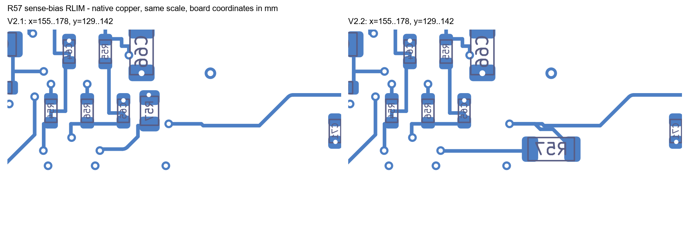
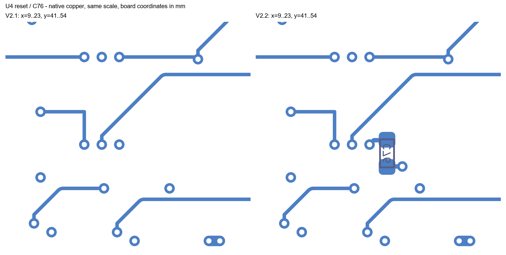
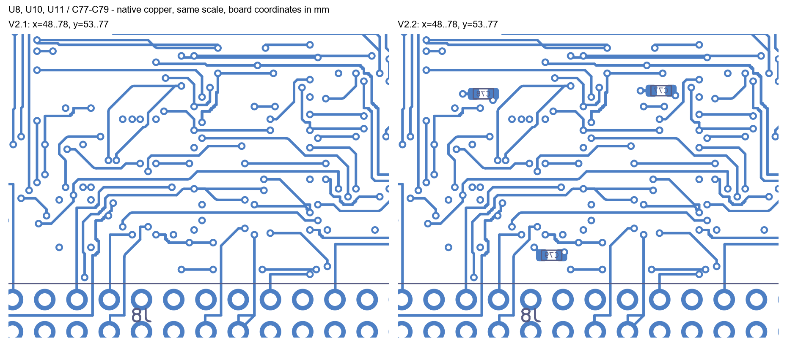

# V2.1 → V2.2 measured comparison

All distances and lengths below come from native CAD geometry, not hardware measurements.

| Metric | V2.1 | V2.2 |
|---|---:|---:|
| Q1 gate_track_mm | 39.7185 | 39.7185 |
| Q1 gate_vias | 3.0000 | 3.0000 |
| Q1 gate_track_over_kelvin_pour_fraction | 0.2148 | 0.2148 |
| Q2 gate_track_mm | 82.1252 | 82.1252 |
| Q2 gate_vias | 14.0000 | 14.0000 |
| Q2 gate_track_over_kelvin_pour_fraction | 0.2436 | 0.2436 |
| Control U4 maximum supply-pad to nearest bypass-pad distance | 26.5037 | 1.5117 |
| Control U8 maximum supply-pad to nearest bypass-pad distance | 10.3926 | 1.0020 |
| Control U10 maximum supply-pad to nearest bypass-pad distance | 7.2028 | 4.4109 |
| Control U11 maximum supply-pad to nearest bypass-pad distance | 9.5876 | 4.2628 |

Pad distance is not route length. Gate-net sums are not loop inductance. A passing DRC does not close the independent review’s insulation, electrothermal or mechanical issues.

See `validation.json` for calculations, source hashes and native-check references.

## Native copper comparisons

Equal-scale native KiCad B.Cu / B.Fab / Edge.Cuts plots, viewed through the board without mirroring. These images show local changes; they do not establish current capability or loop inductance.

